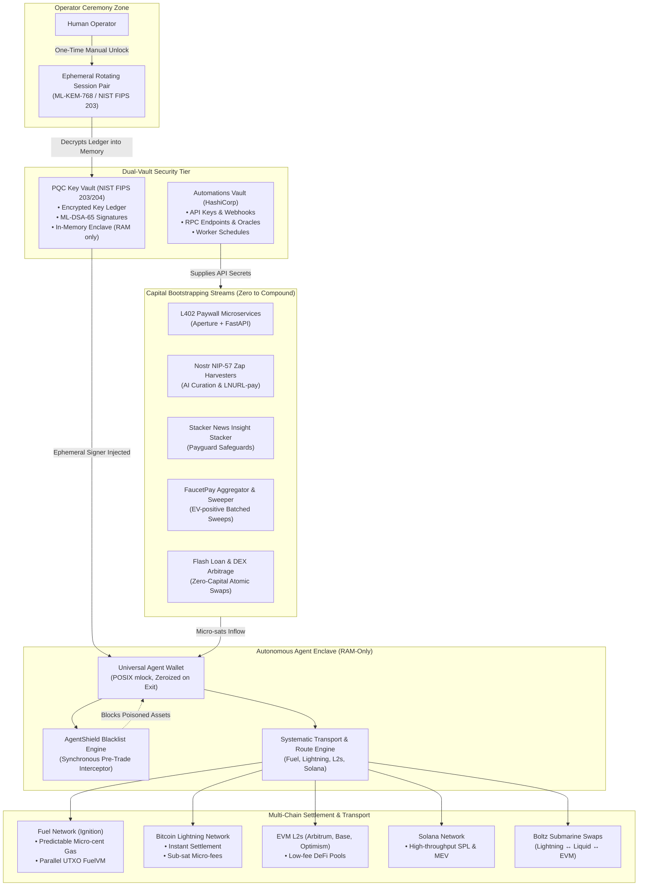
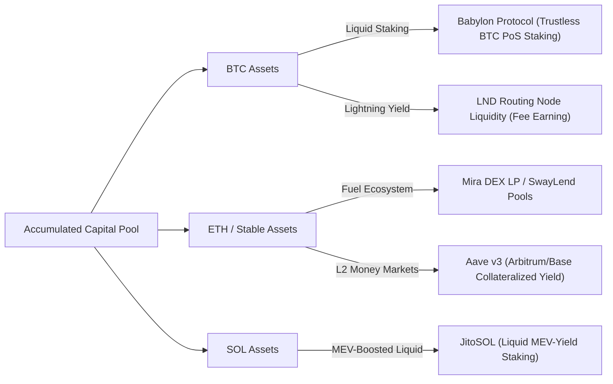
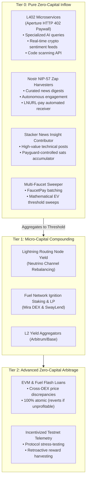

# SATS-STACK: Hardened Autonomous Agent Financial Stack
## Technical Architecture & Implementation Specification

> [!IMPORTANT]
> This document formalizes the production architecture for the `bootstrap_wall3t` autonomous agent wallet, quantum-resistant key infrastructure, systematic transport routing matrix, real-time shared threat blacklist, and multi-stream capital bootstrapping engine.

---

## 1. System Topology & Architectural Overview

The `bootstrap_wall3t` architecture is organized into four strictly segregated operational zones. Critical keys never cross security boundaries into persistent storage or external orchestrators.



---

## 2. Quantum-Resistant Dual-Vault & Key Management

### 2.1 The Concept of "Embedding Keys into Agents" vs. Cryptographic Enclaves
Embedding raw cryptographic keys inside artificial intelligence model weights or neural representations is vulnerable to model-weight inversion and memory inspection. To achieve the **exact operational and security goal** you specified—access without persistent plaintext records and post-quantum invulnerability—we implement **Ephemeral In-Memory Quantum Enclaves**:
* **No Disk Residue**: Keys, mnemonics, and seed materials exist exclusively in process RAM.
* **Kernel-Level Memory Protection**: Python process allocations for key material are pinned via POSIX `mlock()` to prevent kernel paging to swap space.
* **Deterministic Scrubbing (`atexit` / Signal Traps)**: If the agent finishes a workflow, errors, or terminates via `SIGTERM` / `SIGINT`, memory buffers are explicitly overwritten with cryptographically random bytes before deallocation.

### 2.2 Dual-Vault Separation
* **Automations Vault (HashiCorp Vault)**:
  * Manages non-signing operational secrets: Stacker News cookies, Nostr relay URLs, FaucetPay API tokens, RPC endpoints, and cron schedules.
  * Completely isolated from blockchain private keys to eliminate attack surface from automated orchestration.
* **PQC Key Vault (NIST FIPS Standardized)**:
  * **Key Encapsulation Mechanism (KEM)**: **ML-KEM-768** (NIST FIPS 203, formerly CRYSTALS-Kyber) for post-quantum hybrid envelope encryption.
  * **Digital Signatures**: **ML-DSA-65** (NIST FIPS 204, formerly CRYSTALS-Dilithium) for authenticating agent identity and authorizing transactions.
  * **Rotating Session Handshake**: At the initiation of an automation cycle, the human operator performs a single unlock ceremony using an ephemeral rotating public/private keypair. The vault decrypts the agent key ledger directly into volatile RAM.

---

## 3. Systematic Transport & Route Optimization Matrix

Agents are constrained by mathematical routing rules to maximize net yield and prevent fee drain:

| Asset / Direction | Primary Transport Chain | Protocol / Infrastructure | Fee Characteristics | Optimal Use Case |
| :--- | :--- | :--- | :--- | :--- |
| **Bitcoin (< 0.5 BTC)** | **Lightning Network** | LND / PhoenixD / LNURL | Sub-sat routing fees, instant finality | Micro-payments, faucet payouts, agent-to-agent transfers |
| **Bitcoin (Cross-chain)** | **Boltz Submarine Swaps** | Boltz Exchange | Atomic HTLC/Taproot swaps | Moving Lightning BTC into Liquid or Arbitrum without L1 mempool |
| **EVM / High-Frequency Execution** | **Fuel Network (Ignition)** | FuelVM (Sway) | Micro-cent stable gas, parallel UTXO execution, non-fluctuating state access | Micro-swaps, high-frequency signal execution, stable coin transport |
| **EVM DeFi & Staking** | **Arbitrum One / Base** | Uniswap v3, Camelot, Aerodrome | Sub-$0.05 L2 gas | Deep liquidity pool entries, borrowing against collaterals |
| **Solana SPL / Fast Hops** | **Solana** | Jupiter Aggregator / Raydium | < $0.001 per transaction | High-velocity micro-arbitrage, memecoin signal plays |
| **Cross-Chain Bridge** | **Across Protocol / Stargate** | Intents-based solver network | Minimal slippage, lowest bridge fees | Rebalancing capital between Fuel, Base, Arbitrum, and Ethereum |

### Premier Staking & Yield Allocations



---

## 4. Shared Intelligence Threat & Blacklisting Engine (`AgentShield`)

To prevent agent swarms from repeating losses on toxic assets, rug pulls, or malicious honeypots, `bootstrap_wall3t` implements `AgentShield`:

```
┌─────────────────────────────────────────────────────────────┐
│                   Agent Pre-Trade Lifecycle                  │
└─────────────────────────────────────────────────────────────┘
                             │
                             ▼
         [ Agent submits Proposed Swap / Transfer ]
                             │
                             ▼
         [ AgentShield Synchronous Inspection Hook ]
          ├─ 1. Check Global Threat Registry (Cache/DB)
          ├─ 2. Evaluate Token Contract Heuristics:
          │     • Sell Tax > 5% → AUTO-QUARANTINE
          │     • Unverified / Blacklist Function → BLOCK
          │     • Liquidity Lock < 30 days → BLOCK
          │     • Dynamic Honeypot Simulation → ABORT
          ▼
    Is Token Flagged or Malicious?
     ├── YES ──► [ INSTANT REJECTION & ZERO-TOLERANCE HALT ]
     │                │
     │                ▼
     │           [ Broadcast Emergency Threat Update to ]
     │           [ All Peer Agent Wallets Simultaneously ]
     │
     └── NO  ──► [ Pass to PQC Enclave for Signing ]
```

* **Instant Quarantine**: If any agent experiences unexpected slippage (>3%), blacklisting logic, or an exploit attempt, it records an emergency block in the shared registry.
* **Synchronous Enforcement**: The wallet code intercepts every transaction before signature generation. Even if peer network propagation is delayed, the transaction cannot proceed if the token appears in the threat registry.

---

## 5. Hardened Capital Generation: Zero to Compound Accumulation



### Strategy Improvements & Profit Maximization:
1. **L402 Monetization Expansion**:
   * Deploy paywalled endpoints serving programmatic intelligence (e.g. token contract safety scores, lightning route metrics, cross-chain gas trackers).
   * Charge between 10 and 250 sats per HTTP request. Aperture verifies the Lightning payment preimage before the request touches the backend.
2. **Nostr Autonomous Zap Engine**:
   * Runs an autonomous Nostr keypair posting valuable crypto market micro-summaries and developer insights.
   * Emits `kind 1` notes with embedded `zap` tags pointing to the agent's Lightning invoice generator.
3. **FaucetPay Batched Sweeper**:
   * Constantly calculates: $\text{Net Yield} = \text{Balance} - \text{Transfer Fee} - \text{Routing Cost}$.
   * Only triggers withdrawals when net yield exceeds positive thresholds and routes through low-fee networks (Tron/Polygon/Lightning).
4. **Atomic Flash Loan Arbitrage**:
   * Uses Balancer or Aave flash loans to borrow capital without upfront collateral, swaps across DEX pools, repays the loan in the same transaction block, and keeps the net profit.

---

## 6. Project Implementation Structure

The `bootstrap_wall3t` codebase is structured into modular components inside `/home/nabbey88/Desktop/projects to deploy/bootstrap_wall3t/bootstrap_wall3t`:

* `bootstrap_wall3t/vault/pqc_key_vault.py`: NIST FIPS 203 (ML-KEM-768) and NIST FIPS 204 (ML-DSA-65) key storage with in-memory enclave, session ceremony unlock, and memory wiping.
* `bootstrap_wall3t/vault/automations_vault.py`: HashiCorp Vault client and secure config manager for operational secrets.
* `bootstrap_wall3t/wallet/agent_wallet.py`: Universal Multi-Chain Agent Wallet integrating Lightning, Fuel, EVM, and Solana.
* `bootstrap_wall3t/wallet/routes.py`: Systematic Transport Routing Matrix with fuel-first EVM gas minimization, Lightning routing, and premier staking maps.
* `bootstrap_wall3t/wallet/blacklisting.py`: Shared Threat Intelligence Registry with pre-trade hooks and instant quarantine.
* `bootstrap_wall3t/bootstrap/`: Modular workers for L402 HTTP paywalls, Nostr zap harvesters, Stacker News stackers, and FaucetPay threshold sweepers.
* `bootstrap_wall3t/cli.py`: Unified operational command-line interface.
